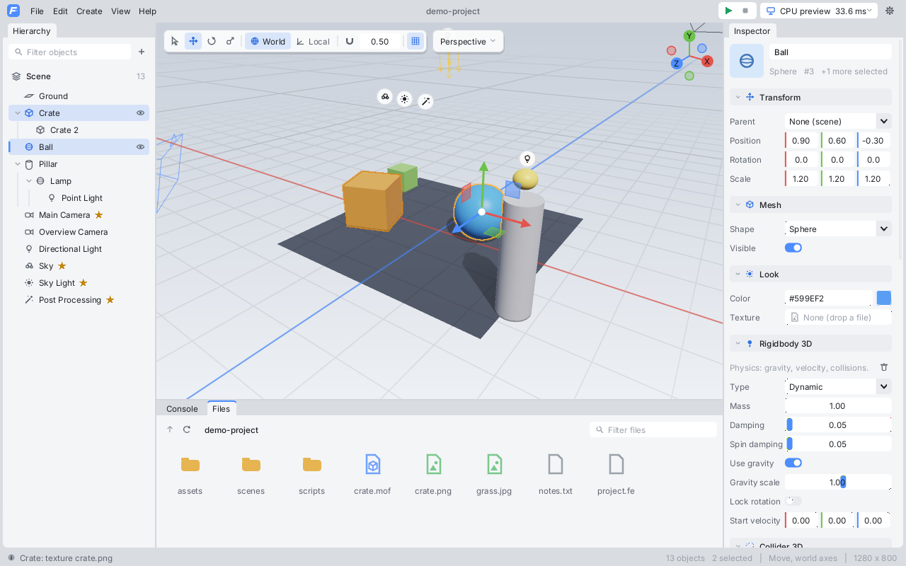
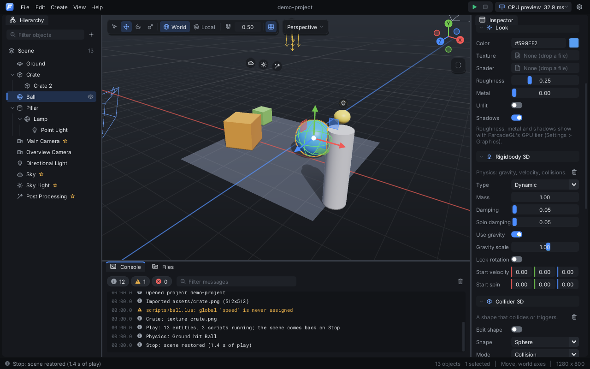
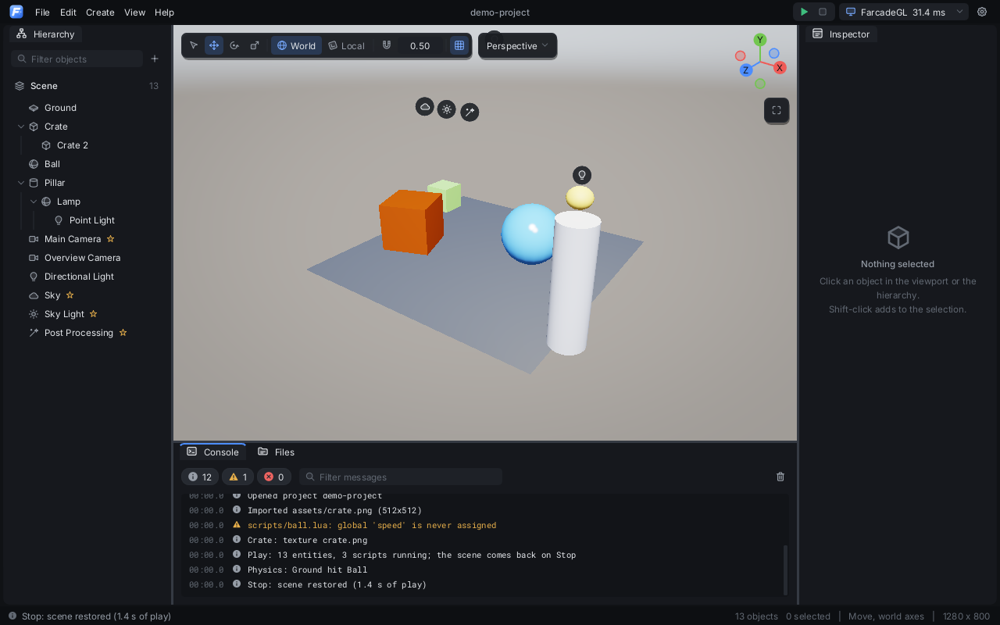
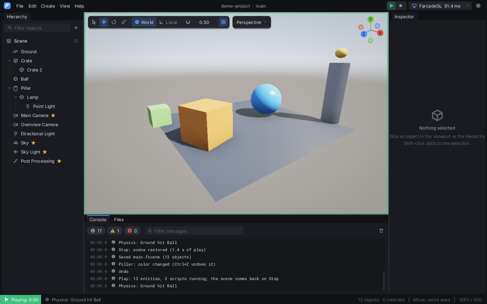
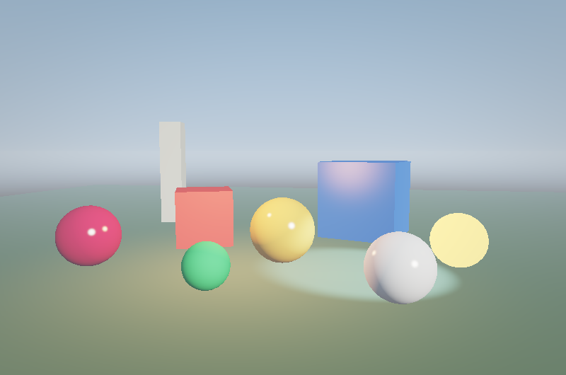
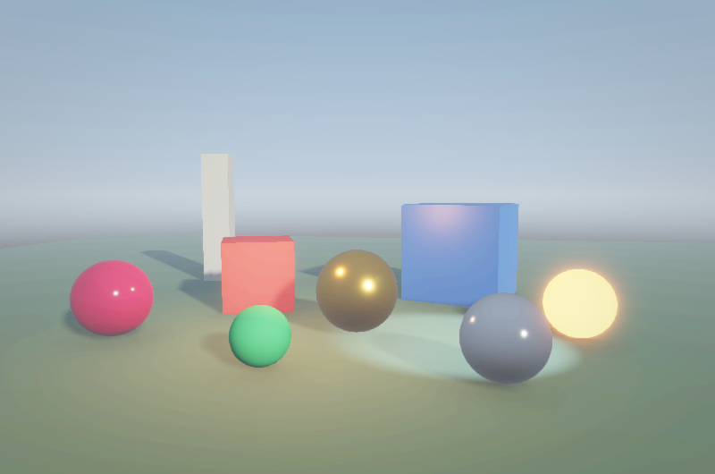
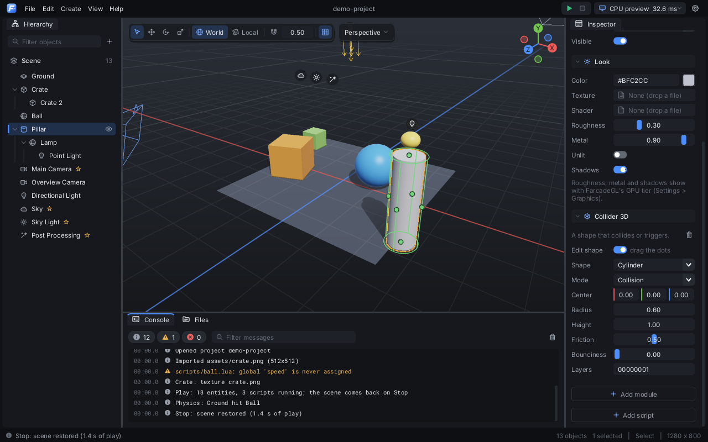
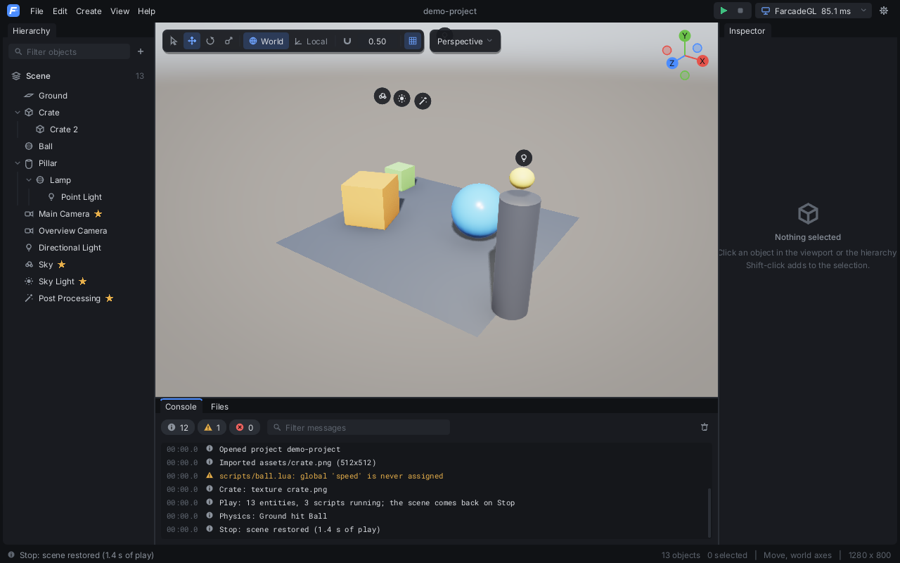
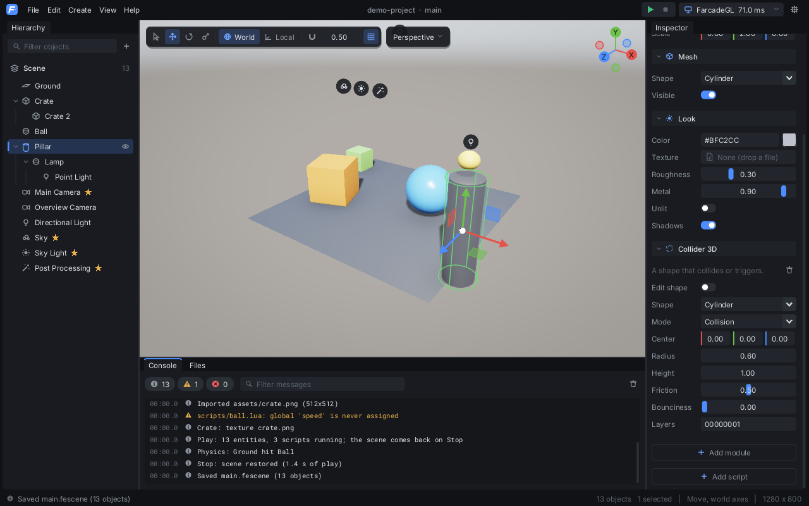
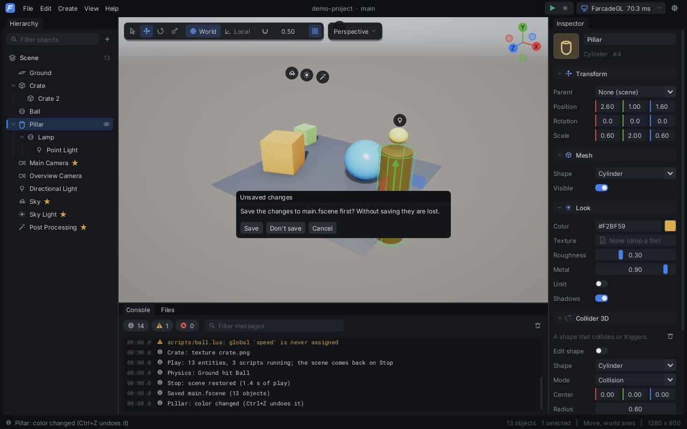

# Farcade Engine

A game engine for [Minimal-OS](https://github.com/fsminecrafter/Minimal-OS):
the editor and the games run on Minimal-OS; the engine itself is developed
on a PC (Linux) and tested there and in QEMU.

The plan behind it is `docs/farcade-engine-plan.md` in the Minimal-OS
repository.


## Screenshots

| | |
|---|---|
|  |  |
| **Light theme**: the same scene; the parent/child tree in the Hierarchy | **Modules**: Rigidbody 3D, Collider 3D and Audio Sampler on the ball (`docs/modules.md`) |
|  |  |
| **Scene objects**: a camera with its Current switch; cameras, lights, sky, sky light and post processing in the tree (current ones starred) | **Play mode**: the scene is saved and comes back on Stop |
|  |  |
| **FarcadeGL** draws the viewport: the sun, the sky, the sky light and post processing (renderer menu, top right) | **Play** looks through the current camera (Main Camera) |
|  |  |
| **FarcadeGL, base tier** (runs everywhere, also on the CPU) | **GPU tier** (Ultra): sun shadows, ambient occlusion, bloom, PBR metals, FXAA, fog. On by default only on a graphics card |
|  |  |
| **Collider shapes**: Edit shape, then drag the dots (height, radius, box size) | The editor viewport with the GPU tier forced on (Settings > Graphics) |
|  |  |
| **Materials**: roughness, metal, unlit and shadows per object (Look); the scene saved as `scenes/main.fscene` | **Unsaved changes**: New scene, Open and Quit ask first; Ctrl+Z / Ctrl+Y undo and redo every edit |


*The editor running full screen on Minimal-OS (QEMU, 1024x768), with the
entity system linked in.*

The screenshots come from `build/host/bin/fe-editor-shot <dir>`, which
renders the editor headless on the PC, and from `tools/ci/run_os.sh` with
`SCREENDUMP` on Minimal-OS.

## Layout

| Directory | What |
|---|---|
| `engine/` | the engine libraries: core (math, `.fepak` packages, VFS), `.mof` models, scene modules (`scene/`), the entity system on flecs (`ecs/`), the FarcadeGL renderer (`gfx/`), Lua scripts (`script/`), physics (`physics/`) |
| `editor/` | the editor (Dear ImGui, drawn by a software rasterizer); also the scene, play session, project settings and exporter code the player shares (`editor/src`) |
| `player/` | `feplayer`: runs an exported game (package or project folder), full screen or in a MOSdesk window; headless on the PC |
| `runtime/minimalos/` | the small C/C++ runtime the engine needs on Minimal-OS |
| `tools/` | PC tools (model converter, CI scripts) |
| `tests/` | tests |
| `external/` | third-party code at pinned versions (`external/VERSIONS.md`) and the Minimal-OS SDK (submodule) |
| `mk/` | one make fragment per part |

## Building

```sh
git submodule update --init
make host      # Linux: tools, tests, headless editor
make test      # run the host tests
make os        # Minimal-OS programs (needs x86_64-elf-gcc/g++, see the SDK)
```

## Rendering and the entity system

- **Editor settings**: Settings > General can invert mouse-wheel scrolling and viewport zoom; press F11 to toggle a desktop window's borderless fullscreen mode. Graphics settings (Settings > Graphics, `engine/gfx/graphics_settings.h`, `docs/graphics.md`) offer presets Low to Ultra. The GPU tier (shadow maps with soft PCF, SSAO, bloom, FXAA, GGX PBR) runs only when FarcadeGL is on a graphics card, unless forced with "Use on the CPU".
- **FarcadeGL renderer** (`engine/gfx`, `fe::gfx::Renderer`): draws meshes with directional, point and spot lights (up to 8), hemisphere ambient from the Sky Light, a gradient sky with a sun, and post processing (exposure, ACES/Reinhard, contrast, saturation, tint, vignette) through the SDK's `farcadegl.h`. On Minimal-OS that runs on the kernel's FGPU; on the PC the same calls run on a copy of the FGPU CPU backend (`engine/gfx/host`, `external/fgpu`), so `gfx_tests` and `fe-gfx-shot` check it there. Shadows, AO and bloom are in the GPU tier (above).
- **Entity system** (`engine/ecs`, `docs/ecs.md`): flecs v4 behind a small `fe::World` API. Modules are components (with flecs reflection built from the same field tables as the Inspector), the transform hierarchy is a system, and "current" is enforced there too. The editor's Play runs the scene as a world.
- **Scripts** (`engine/script`, `docs/scripting.md`): Lua 5.4 in a sandbox, one instance per script on an object, with its editor inputs in `self`. Scripts reach other objects' scripts (`self.door:script("door"):open()`), modules (`obj.light.intensity`, `obj.camera.current = true`), the look (`obj.material.metallic = 1`), events (`obj:send`, `fe.broadcast`) and physics callbacks. They run in Play.
- **Physics** (`engine/physics`): a built-in step for Rigidbody 3D and Collider 3D (gravity, box, sphere, capsule, cylinder and convex mesh collisions, rolling and tipping, bounce, friction, triggers), a stand-in for Jolt.
- **Modules and scene objects**: `docs/modules.md`: besides Rigidbody, Collider, Light and the audio modules there are Particle Emitter, Joint 3D, Animator (`docs/animation.md`), Force Field, Spawner, Audio Reverb Zone, Billboard and Text 3D (`engine/fx`).
- **Scene files** (`.fscene`, `editor/src/scene_io.h`, `docs/scenes.md`): File > Save scene (Ctrl+S), Save scene as, and double-click a scene in Files to open it. Readable text; every value is stored by name, so newer fields read back as defaults from older files. New scene, Open and Quit ask before unsaved changes are lost.
- **Undo and redo** (Ctrl+Z, Ctrl+Y / Ctrl+Shift+Z): every edit in the editor, a drag counts as one step (`docs/scenes.md`).

```sh
build/host/bin/fe-gfx-shot out.png            # the renderer alone, a demo scene
tools/ci/run_os.sh build/os/bin/gfx_smoke.run 'FE GFX PASS' 'FE GFX FAIL'
tools/ci/run_os.sh build/os/bin/ecs_smoke.run 'FE ECS PASS' 'FE ECS FAIL'
tools/ci/run_os.sh build/os/bin/script_smoke.run 'FE SCRIPT PASS' 'FE SCRIPT FAIL'
ARGS=--play tools/ci/run_os.sh build/os/bin/farcade-editor.run 'FE EDITOR frames 181'
ARGS=--farcadegl tools/ci/run_os.sh build/os/bin/farcade-editor.run 'FE EDITOR frames 121'
```

## Exporting a game

`File > Project settings...` edits `project.fe` (name, version, entry scene, window size, icon); `File > Export game...` writes `<Name>.fepak` (every scene and the scripts, models, textures and sounds they use, `docs/pak-format.md`) and a copy of the prebuilt player `feplayer` as `<Name>.run`, by default into `0:/games/<Name>/`. The player runs the scene like the editor's Play (same `PlaySession`: Lua, physics, audio, the current camera, FarcadeGL), full screen or as a MOSdesk window; Esc quits. Scripts read the keyboard and mouse with `fe.key_down("w")`, `fe.mouse_x()` ... (`docs/scripting.md`). Details in `docs/export.md`.

```sh
build/host/bin/fe-export MyProject out/                        # the editor's export on the PC, no screen
build/host/bin/feplayer out/MyGame.fepak --frames 60 --png shot.png   # headless run: checksum and PNG
run 0:/programs/farcade-editor.run --export 0:/projects/MyGame 0:/games/MyGame   # on Minimal-OS
tools/ci/export_os_test.sh                                     # QEMU: export from the editor, run the result
```

## Models: `.mof`

`.mof` is the engine's model file: meshes (positions, normals, tangents,
two UV sets, colors), materials, textures (raw RGBA8 with mips, PNG or
JPEG), a skeleton (bones with inverse bind matrices, joints and weights)
and a node tree, in one little-endian file of 16-byte aligned chunks. The
byte-level specification is `docs/mof-format.md`; the reader and writer
are `engine/mof/mof.h` (the reader is freestanding and zero-copy).

```sh
build/host/bin/mofconv model.glb model.mof     # from glTF 2.0 (.gltf/.glb) or OBJ (+MTL)
build/host/bin/mofconv --info model.mof        # what is inside
make mof-samples                               # rebuild assets/samples/*.mof
make test-mof-asan                             # the .mof tests under ASan/UBSan
```

## On Minimal-OS

`make os` builds `build/os/bin/farcade-editor.run` (the editor, full
screen), `build/os/bin/feplayer.run` (the game player: install it next to
the editor as `0:/programs/feplayer.run`, the editor's export copies it) and
`build/os/bin/imgui_smoke.run` (a self-test), linked with the
engine's own C/C++ runtime (`runtime/minimalos`, see `docs/runtime.md`).
`tools/ci/run_os.sh` puts a program into a Minimal-OS boot image, runs it in
QEMU and waits for a line on the serial port:

```sh
SCREENDUMP=$PWD/build/os/editor.png ARGS="--frames 200" \
  tools/ci/run_os.sh build/os/bin/farcade-editor.run 'FE EDITOR frames 121' 'FE EDITOR FAIL'
tools/ci/run_os.sh build/os/bin/imgui_smoke.run 'FE SMOKE PASS' 'FE SMOKE FAIL'
```

It builds in a Minimal-OS checkout (`MINIMAL_OS_DIR`, default
`/home/user/wt-mos-rt`); the variables are listed at the top of the script.
