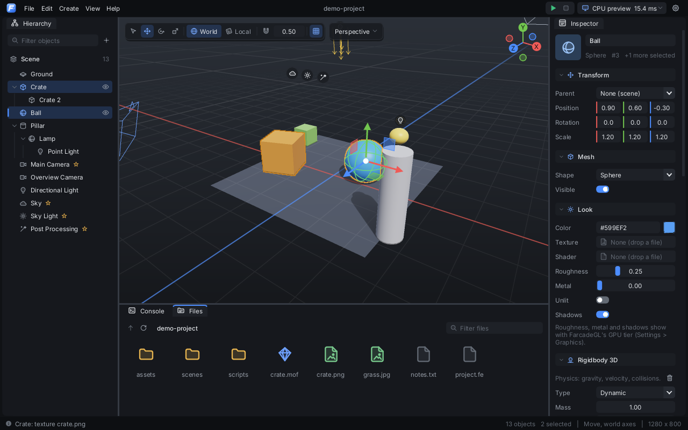
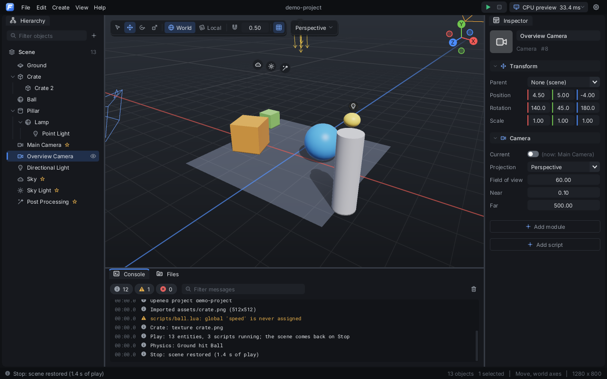
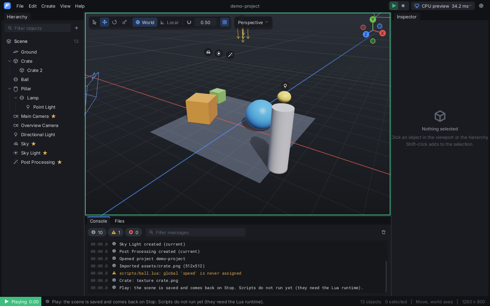
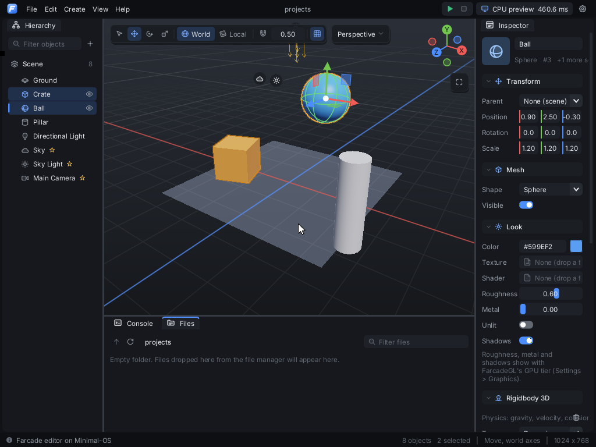

# Farcade Engine

A game engine for [Minimal-OS](https://github.com/fsminecrafter/Minimal-OS):
the editor and the games run on Minimal-OS; the engine itself is developed
on a PC (Linux) and tested there and in QEMU.

The plan behind it is `docs/farcade-engine-plan.md` in the Minimal-OS
repository.



## Screenshots

| | |
|---|---|
|  |  |
| **Light theme**: the same scene; the parent/child tree in the Hierarchy | **Modules**: Rigidbody 3D, Collider 3D and Audio Sampler on the ball (`docs/modules.md`) |
|  |  |
| **Scene objects**: a camera with its Current switch; cameras, lights, sky, sky light and post processing in the tree (current ones starred) | **Play mode**: the scene is saved and comes back on Stop |



*The editor running full screen on Minimal-OS (QEMU, 1024x768), from an
earlier build.*

The screenshots come from `build/host/bin/fe-editor-shot <dir>`, which
renders the editor headless on the PC, and from `tools/ci/run_os.sh` with
`SCREENDUMP` on Minimal-OS.

## Layout

| Directory | What |
|---|---|
| `engine/` | the engine libraries (core, `.mof` models, scene modules, ...) |
| `editor/` | the editor (Dear ImGui, drawn by a software rasterizer) |
| `runtime/minimalos/` | the small C/C++ runtime the engine needs on Minimal-OS |
| `tools/` | PC tools (model converter, CI scripts) |
| `tests/` | tests |
| `external/` | third-party code at pinned versions (`external/VERSIONS.md`) and the Minimal-OS SDK (submodule) |
| `mk/` | one make fragment per part |

## Building

```sh
git submodule update --init
make host      # Linux: tools, tests, headless editor
make test      # run the host tests
make os        # Minimal-OS programs (needs x86_64-elf-gcc/g++, see the SDK)
```

## Models: `.mof`

`.mof` is the engine's model file: meshes (positions, normals, tangents,
two UV sets, colors), materials, textures (raw RGBA8 with mips, PNG or
JPEG), a skeleton (bones with inverse bind matrices, joints and weights)
and a node tree, in one little-endian file of 16-byte aligned chunks. The
byte-level specification is `docs/mof-format.md`; the reader and writer
are `engine/mof/mof.h` (the reader is freestanding and zero-copy).

```sh
build/host/bin/mofconv model.glb model.mof     # from glTF 2.0 (.gltf/.glb) or OBJ (+MTL)
build/host/bin/mofconv --info model.mof        # what is inside
make mof-samples                               # rebuild assets/samples/*.mof
make test-mof-asan                             # the .mof tests under ASan/UBSan
```

## On Minimal-OS

`make os` builds `build/os/bin/farcade-editor.run` (the editor, full
screen) and `build/os/bin/imgui_smoke.run` (a self-test), linked with the
engine's own C/C++ runtime (`runtime/minimalos`, see `docs/runtime.md`).
`tools/ci/run_os.sh` puts a program into a Minimal-OS boot image, runs it in
QEMU and waits for a line on the serial port:

```sh
SCREENDUMP=$PWD/build/os/editor.png ARGS="--frames 200" \
  tools/ci/run_os.sh build/os/bin/farcade-editor.run 'FE EDITOR frames 121' 'FE EDITOR FAIL'
tools/ci/run_os.sh build/os/bin/imgui_smoke.run 'FE SMOKE PASS' 'FE SMOKE FAIL'
```

It builds in a Minimal-OS checkout (`MINIMAL_OS_DIR`, default
`/home/user/wt-mos-rt`); the variables are listed at the top of the script.
